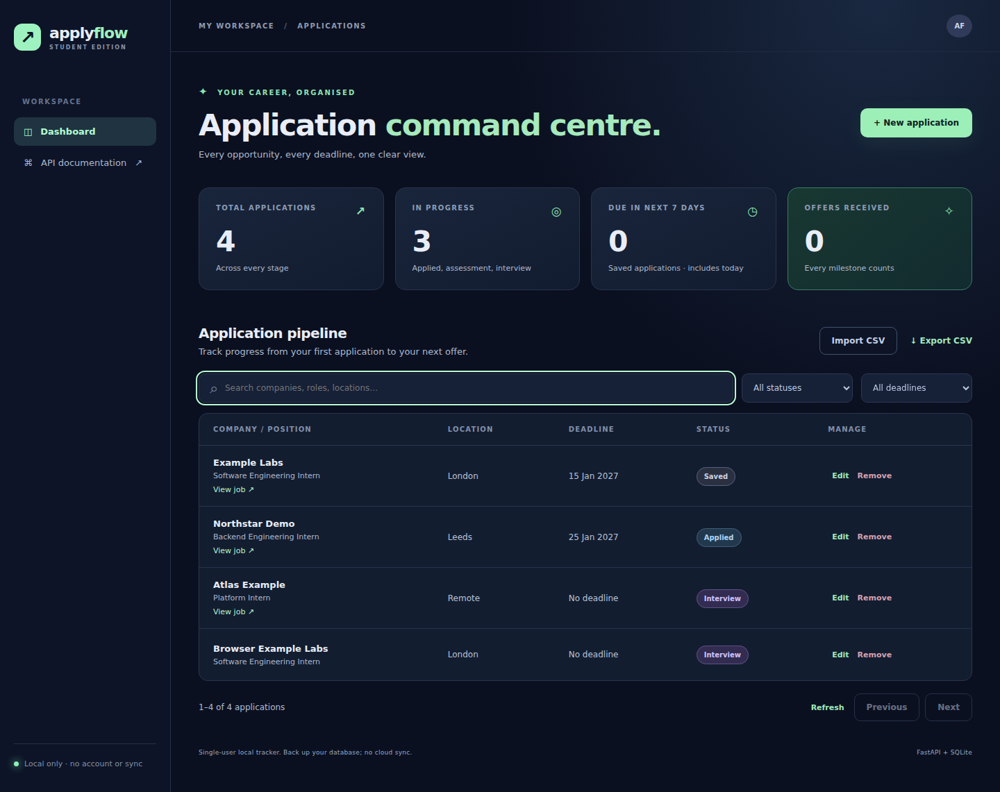

# ApplyFlow

A local internship application tracker that keeps opportunities, deadlines and application stages in one place. A plain JavaScript dashboard talks to a typed FastAPI API, with SQLite providing durable storage and transactional imports.

**Verified:** 62 API/database tests and 5 subtests passed; GitHub Actions checks Python 3.12/3.13 and real Chromium workflows. Desktop and mobile screenshots were visually reviewed. See the [verification record](docs/VERIFICATION.md) for evidence and remaining limits.



[Mobile screenshot](docs/images/mobile.png)

## Why this project exists

Internship applications quickly become a mixture of spreadsheets, bookmarks and notes. ApplyFlow gives a single user a searchable pipeline, clear deadlines and portable CSV records without a cloud account.

## Features

- Create, view, edit and remove applications across six stages.
- Search company, role and location; combine status and deadline filters; browse paginated results.
- See totals, active applications, offers, saved applications due in the next seven calendar days, and overdue saved applications.
- Import up to 500 CSV rows atomically, with row-level validation errors. One bad row or duplicate rolls back the whole batch.
- Export spreadsheet-safe CSV; make a consistent SQLite backup with an integrity check.
- Preserve starter databases through an atomic schema migration.
- Use labelled dialogs, inline errors, visible focus states and a mobile card layout.

## Quick start

Use **Python 3.12 or 3.13**. The full application is not supported on the Python 3.9 bundled with some macOS installations.

```bash
python3.12 -m venv .venv
source .venv/bin/activate
python -m pip install -r requirements-dev.txt
python -m uvicorn app:app --host 127.0.0.1 --port 8000 --reload
```

On Windows, create the environment with `py -3.12 -m venv .venv` and activate it with `.venv\Scripts\activate` in Command Prompt or `.venv\Scripts\Activate.ps1` in PowerShell.

Open <http://127.0.0.1:8000>. OpenAPI documentation is at <http://127.0.0.1:8000/docs>; its Swagger assets need internet access. The dashboard itself uses no external fonts, scripts or analytics.

By default the database is `data/applications.db`. Set `APPLYFLOW_DB` to select another path. The startup lifespan creates or migrates the database; importing the Python module does not write to it. Back up an existing database before an upgrade.

Try **Import CSV** using [fictional sample data](examples/applications.csv), also downloadable in the dashboard. These organisations and opportunities are examples, not real vacancies.

### Tests

```bash
python -m pytest -q
# The standard-library persistence checks can also run independently:
python -m unittest discover -s tests -p 'test_database.py' -v
python -m unittest discover -s tests -p 'test_backup.py' -v
```

Optional real-browser checks start their own server with a temporary database:

```bash
python -m pip install -r requirements-browser.txt
python -m playwright install chromium
python tests/browser_smoke.py
```

On Linux CI, use `python -m playwright install --with-deps chromium`. The script exercises CRUD, restart persistence, CSV import/export, search, dialog keyboard behaviour and desktop/mobile overflow, and saves screenshots in ignored `browser-artifacts/`.

The workflow runs API checks on Python 3.12/3.13 and a Chromium smoke job. [Verified successful run](https://github.com/Rudransh7/applyflow-internship-tracker/actions/runs/40079241869).

### Back up and restore

```bash
python scripts/backup.py backups/before-upgrade.db
# Optional different source:
python scripts/backup.py backups/snapshot.db --source data/applications.db
```

The backup command uses SQLite's backup API, so it can take a consistent snapshot while the app is running. It will not overwrite an existing file. To restore, stop the app, preserve the current database, then copy a chosen backup to `data/applications.db` before restarting. Test restores on a separate database path first. CSV exports are **not** lossless backups: IDs/timestamps are regenerated on import and formula-like text is prefixed for spreadsheet safety.

## Architecture

| Layer | Responsibility |
|---|---|
| `static/` | Dashboard, accessible forms, server-side filtering requests, error and loading states |
| `applyflow/api.py` | HTTP routes, status codes, lifespan and local-browser boundary |
| `applyflow/models.py` | Pydantic request/response contracts |
| `applyflow/repository.py` | Parameterised SQL, ordering, statistics and transactions |
| `applyflow/database.py` | Connections, constraints and versioned migration |
| `applyflow/csvio.py` | Bounded CSV parsing and safe export |
| `scripts/backup.py` | Consistent SQLite snapshots |

SQLite suits a personal tracker: no separate database service, simple backups, and database-enforced uniqueness. Plain JavaScript keeps the frontend build-free. There is one table, so an ORM and a general migration framework would add more machinery than value here.

See [API contracts](docs/API.md), [design decisions and security](docs/DESIGN.md), [verification evidence](docs/VERIFICATION.md) and [ownership/interview guide](docs/OWNERSHIP.md).

## Local security boundary

This is a **single-user local application**, not a public SaaS product. Bind to `127.0.0.1`; do not expose it through a public server or tunnel with real application data.

Host checks, same-origin mutation checks, a required custom request header, parameterised SQL, HTML-safe text insertion and restrictive dashboard security headers reduce browser-facing risks. They do not authenticate local users or encrypt the database. Protect your operating-system account and backups. A hosted version needs proper identity, per-user data ownership, HTTPS, secrets management and a storage threat model.

## Provenance

This repository began as an AI-assisted starter. The original CRUD API, dashboard, uniqueness constraint, CSV export and eight API tests were already present. The subsequent refactor, import/migration/backup features, security hardening and expanded tests were also implemented with AI assistance. [The ownership guide](docs/OWNERSHIP.md) identifies meaningful student exercises and the evidence required before claiming personal contributions.

There are no invented users, performance improvements, employer endorsements or independently authored contribution claims.
